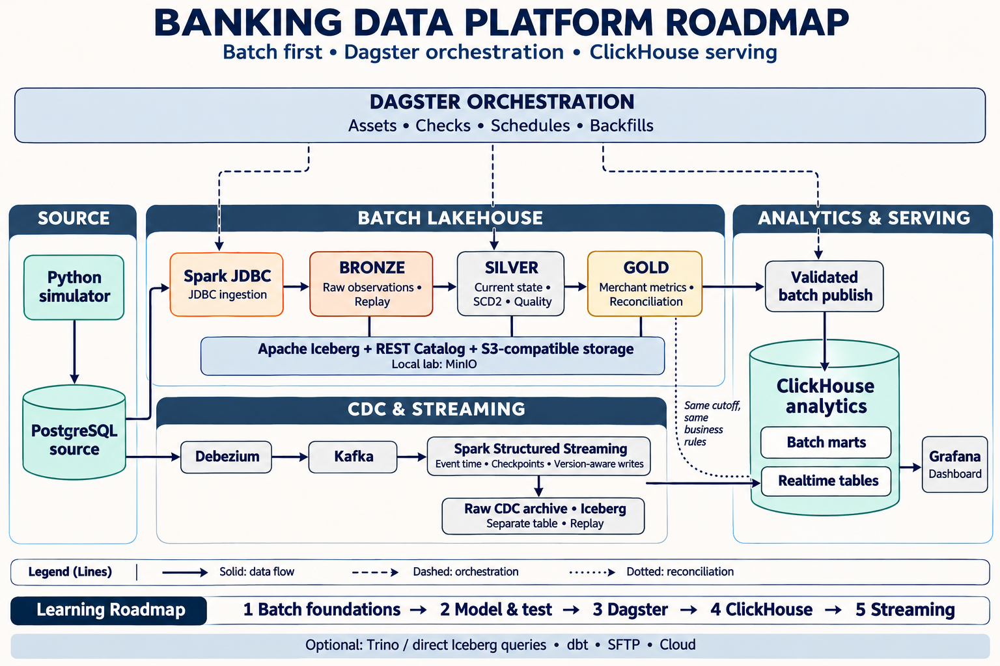

# Banking Data Platform

Project tự học lakehouse và xử lý dữ liệu ngân hàng theo hai luồng batch và streaming. Các thành phần được tổ chức thành thư mục riêng để quản lý dependency, cấu hình và kiểm thử độc lập.

Lộ trình tổng quát: hoàn thành batch có đối soát và khả năng chạy lại trước, dùng **Dagster OSS** điều phối, thêm **ClickHouse → Grafana** phục vụ phân tích, rồi mở rộng **Debezium → Kafka → Spark Structured Streaming → ClickHouse**. Iceberg quản lý Bronze/Silver/Gold trên object storage; PostgreSQL là nguồn nghiệp vụ. Plan và tiêu chí nghiệm thu nằm trong [Data Modeling & Ingestion Strategy](contracts/DATA_MODELING_AND_INGESTION.md#11-lộ-trình-học-và-tiêu-chí-nghiệm-thu).



[Tải roadmap PNG](docs/assets/banking-platform-roadmap.png). Sơ đồ thể hiện kiến trúc mục tiêu và thứ tự học: batch → modeling và kiểm thử → Dagster → ClickHouse → streaming. Trino là bài mở rộng tùy chọn.

```text
banking-project/
├── README.md
├── .gitignore
├── data-source/     # Simulator thanh toán QR/POS → PostgreSQL
├── batch/           # Phase 1: batch lakehouse, Bronze → Silver → Gold
├── streaming/       # Phase 2: CDC, Kafka và xử lý realtime
├── contracts/       # Định nghĩa dữ liệu dùng chung và plan
└── docs/assets/     # Một ảnh roadmap tổng quát
```

| Thành phần | Phạm vi | Hướng dẫn |
| --- | --- | --- |
| `data-source/` | Simulator Python + PostgreSQL | [README simulator](data-source/README.md) |
| `batch/` | Batch lakehouse Bronze → Silver → Gold | [README batch](batch/README.md) |
| `streaming/` | CDC, Kafka và xử lý realtime | [README streaming](streaming/README.md) |
| `contracts/` | Contract nguồn, mapping và plan | [README contracts](contracts/README.md) |

## Chạy simulator

Từ thư mục gốc repo:

```bash
cd data-source
python3.14 -m venv .venv
source .venv/bin/activate
python -m pip install -e '.[test]'
```

Làm tiếp theo [hướng dẫn cấu hình và chạy simulator](data-source/README.md#chạy-nhanh). File `.env` và `config.toml` của simulator nằm trong `data-source/`. Các lệnh simulator, lệnh mở SSH tunnel và lệnh kiểm thử trong tài liệu được chạy từ thư mục đó.

Nếu đã cài simulator trước khi đổi cấu trúc, hãy kích hoạt virtualenv mới ở `data-source/.venv/` và cài lại package theo các lệnh trên. Virtualenv cũ ở root không được di chuyển vì các đường dẫn cài đặt gắn với vị trí cũ.

## Quy ước

- Mỗi thành phần có README, cấu hình và môi trường Python riêng khi được triển khai.
- Simulator cung cấp dữ liệu qua PostgreSQL. Batch và streaming đọc nguồn qua các kết nối dữ liệu, không import code nghiệp vụ của simulator.
- `.env`, `config.toml` và virtualenv được bỏ qua bởi `.gitignore` ở root. Chỉ commit cấu hình mẫu không chứa thông tin kết nối thật.
- Định nghĩa dữ liệu dùng chung đặt trong `contracts/`. Hạ tầng dùng chung sẽ được bổ sung khi triển khai các phase tiếp theo.
