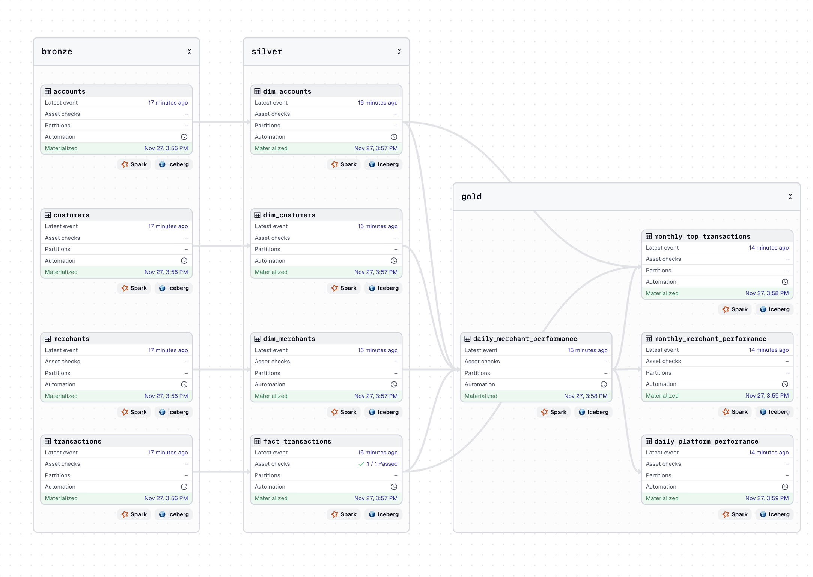

# Điều phối batch bằng Dagster OSS

Dagster khởi chạy các job Spark hiện có trong service `spark-master`. Spark đọc PostgreSQL và ghi Iceberg qua REST Catalog và MinIO. Dagster lưu lịch sử run, kết quả quality và metadata để truy ngược batch và snapshot.

## Khởi động

Khởi động [hạ tầng batch](../infra/README.md#khởi-động) và kiểm tra Spark có thể kết nối PostgreSQL. Nếu cấu hình nguồn dùng SSH tunnel thì giữ tunnel chạy trong suốt quá trình. Chạy từ `batch/orchestrator/` với Python 3.12:

```bash
python3.12 -m venv .venv
source .venv/bin/activate
python -m pip install -r requirements.txt

export BANKING_NAMESPACE_SUFFIX=m4_lab
export BANKING_LOAD_MODE=full
export DAGSTER_HOME="$PWD/.dagster_home/$BANKING_NAMESPACE_SUFFIX"
mkdir -p "$DAGSTER_HOME"
cp -n dagster.yaml.example "$DAGSTER_HOME/dagster.yaml"

dagster dev -w workspace.yaml -h 127.0.0.1 -p 3000
```

Mở [Dagster UI](http://127.0.0.1:3000), chọn **Jobs → banking_daily → Launchpad → Launch Run**. Với ví dụ trên, Spark ghi vào `bronze_m4_lab`, `silver_m4_lab` và `gold_m4_lab`. Dùng hậu tố và `DAGSTER_HOME` riêng cho mỗi bộ dữ liệu để lịch sử của các asset hiển thị đúng namespace. Hậu tố mặc định là `m4`. Có thể đặt `BANKING_LOAD_MODE=incremental` cho accounts và transactions khi khởi động lại Dagster. Customers và merchants luôn đọc full. `BANKING_OVERLAP_MINUTES` mặc định là `5`.

File cấu hình Dagster cho phép một run hoạt động tại một thời điểm. Chạy writer qua cùng Dagster instance. Nếu đã hủy run, kiểm tra [Spark master UI](http://localhost:8080) để chắc rằng Spark application cũ đã dừng trước khi chạy writer tiếp theo. Khi đối soát với PostgreSQL, giữ nguồn ổn định trong cả bốn lần đọc JDBC.

## Đọc graph và chạy lại



Đọc từ trái sang phải để theo dõi bảng nào cung cấp dữ liệu cho bảng nào. **1 / 1 Passed** trên `fact_transactions` là kết quả của check `silver_quality`.

| Bước | Asset và kết quả hiển thị trong UI |
| --- | --- |
| Bronze | Bốn asset đại diện bốn bảng. Một step gọi Spark theo thứ tự customers, merchants, accounts, transactions vì các job dùng chung manifest và watermark. Mỗi bảng có batch ID, số dòng nạp, snapshot Iceberg và watermark nếu có. |
| Silver | Mỗi asset đọc bảng Bronze tương ứng qua manifest đã chấp nhận. Một step Spark ghi bốn bảng `dim_customers`, `dim_merchants`, `dim_accounts`, `fact_transactions` qua checkpoint dùng chung. Mỗi asset có snapshot, số dòng xử lý và các batch liên quan. |
| Silver quality | Blocking check `silver_quality` trên `fact_transactions` đọc cả bốn bảng. Check hiển thị snapshot đã đọc, số vi phạm của 16 kiểm tra nghiệp vụ, số dòng quarantine và số tham chiếu batch chưa có checkpoint. |
| Gold | `daily_merchant_performance` tính theo merchant × ngày Việt Nam. Khi có check trong cùng run, Dagster chuyển chính xác các snapshot đã duyệt cho Spark. Spark kiểm tra đầu vào, đối soát số đếm và tiền, rồi ghi `_materializations`. UI hiển thị snapshot đầu vào, đầu ra, số dòng và đối soát VND. |
| Gold tổng hợp | `daily_platform_performance` và `monthly_merchant_performance` đọc snapshot daily Gold đã hoàn thành trong ledger. `monthly_top_transactions` lấy snapshot Silver accounts và transactions từ cùng bản ghi daily Gold. |

- `banking_daily` chạy từ PostgreSQL qua Bronze, Silver, quality và daily Gold. Full load tạo lần quan sát mới trong Bronze.
- `banking_rebuild` tiếp tục từ Bronze đã lưu. Dùng khi cần chạy lại Silver và daily Gold với manifest hiện có. Silver bỏ qua batch đã checkpoint nếu fingerprint còn khớp.
- `banking_refresh_gold` chạy lại quality và daily Gold từ Silver hiện có. Dùng sau khi đã sửa lỗi chất lượng và cần đối chiếu với lần chạy trước.
- `banking_gold_marts` dựng ba mart tổng hợp từ lần daily Gold đã hoàn thành mới nhất.
- `banking_batch` chạy toàn bộ graph. Schedule `banking_batch_daily` đặt lúc **02:00 giờ Việt Nam**, ở trạng thái tắt khi cài đặt. Có thể bật trong **Automation → Schedules** khi nguồn và tunnel sẵn sàng cho chạy định kỳ.

Trong **Runs**, chọn step để xem batch, snapshot và lý do lỗi. Khi quality fail, mở check `silver_quality` để xem số vi phạm. Sau khi sửa fixture hoặc phục hồi snapshot hợp lệ, dùng **Re-execute → From Failure** để chạy lại check và các bước sau đó. Khi có quarantine, đối chiếu `_quarantine`, `_processed_batches` và `_ingestion_batches` theo batch ID trước khi quyết định sửa hoặc dựng lại Silver. Với lỗi hạ tầng, Dagster hiển thị tên job và mã thoát. Dùng [README Spark](../infra/README.md) để kiểm tra Docker, trạng thái nguồn và Spark application.

Đối chiếu kết quả trong `gold_<hậu tố>._materializations`: `source_snapshots`, `output_snapshot_id`, `row_count`, `reconciliation`. Đọc bảng Gold với `VERSION AS OF <output_snapshot_id>` qua Spark SQL để đối soát đúng lần ghi. Trong hai lần chạy dùng cùng đầu vào, so `source_snapshots`, số dòng và tổng VND. Mỗi lần overwrite thành công có thể tạo snapshot đầu ra mới.

Gold hiện tính lại toàn bộ lịch sử từ Silver. Backfill theo ngày trong Dagster cần cách lưu cutoff và lineage theo ngày trước khi khai báo partition.

## Kiểm thử nhanh

```bash
python -m pip install -r requirements-dev.txt
python -m pytest -q
python -m pytest ../infra/tests -q
```

Các test Dagster chạy graph trong tiến trình với báo cáo Spark mẫu. Các test cần Docker Spark và Iceberg được chạy riêng theo [hướng dẫn runtime](../infra/README.md#kiểm-thử-code-và-nghiệm-thu-runtime).

## Nghiệm thu ngày 25/11/2026

Nghiệm thu qua GraphQL của Dagster với namespace thử nghiệm hậu tố `m4_20261125_c814df6b`.

| Run | Kết quả đã kiểm tra |
| --- | --- |
| [Chạy từ PostgreSQL](http://127.0.0.1:3000/runs/5885ca87-8368-47f4-8d7c-248c5370db0f) | Bronze nhận 100 customers, 20 merchants, 120 accounts và 31.808 transactions. Silver đạt 16 kiểm tra với quarantine rỗng. Daily Gold ghi 240 dòng vào snapshot `4659679417587832294`. |
| [Chặn lỗi chất lượng](http://127.0.0.1:3000/runs/411c21fb-0d34-450a-a6eb-26d24bf15d6d) | Tăng số dư một tài khoản trong Silver thử nghiệm thêm 1 VND. Check phát hiện đúng một sai lệch. Gold không chạy. Snapshot Gold và số bản ghi hoàn thành trong ledger giữ nguyên. |
| [Chạy lại từ lỗi](http://127.0.0.1:3000/runs/3956585c-9b3e-4480-9e90-2dae66988730) | Phục hồi snapshot Silver ban đầu rồi chạy **From Failure**. Gold ghi snapshot `1687812713915478172`. So sánh hai chiều cho thấy cả 240 dòng giống nhau trên 12 ngày nghiệp vụ. |
| [Dựng ba mart Gold](http://127.0.0.1:3000/runs/616ca158-54b5-4159-be51-e1d0b1f0755d) | Daily platform ghi 12 dòng, monthly merchant ghi 20 dòng và monthly top transactions ghi 10 dòng. Cả ba đạt đối soát và cùng tham chiếu bản ghi daily Gold của lần chạy lại. |

Hai snapshot daily Gold cùng cho payment **4.046.349.000 VND**, refund **105.230.000 VND** và net **3.941.119.000 VND**. Kết quả khớp đối soát PostgreSQL của M3. Lịch sử Dagster nằm trong `.dagster_home/m4_20261125_c814df6b/`. Bằng chứng trên máy nghiệm thu được ghi trong `/tmp/banking-m4-evidence.json` và `/tmp/banking-m4-marts-evidence.json`.
